# birdcage-palace

Project page: https://benjhardy.github.io/projects/birdcage-palace/ · part of [benjhardy.github.io](https://benjhardy.github.io)

Live builder: https://benjhardy.github.io/birdcage-builder/ (set the specs in the browser, see the ladder-model spectrum,
and download a package that builds, solves and tunes the coil with this repo, with or without the shield or both, and
optionally a loaded run; source in [`web/`](web/birdcage-builder/index.html)). Each mode on the spectrum is coloured
by its field uniformity (std/mean of the transverse |B| over r < 0.6 R, |z| < L/6) from a quasi-static Biot–Savart
model of the ladder currents ([`birdcage_palace/uniformity.py`](birdcage_palace/uniformity.py)); on the three
reference coils it is within 1 percentage point of Palace at k = 1 (3.2 % vs 3.4–4.0 %) and within 2.5 % relative for
k = 2–8 ([`tests/test_uniformity.py`](tests/test_uniformity.py)).

An open-source, scriptable builder for MRI birdcage RF coils. It sizes the capacitors with a ladder-network model,
builds the coil in [Gmsh](https://gmsh.info), solves the full-wave eigenmodes with the
[Palace](https://github.com/awslabs/palace) finite-element solver, and then picks out the one mode that
matters for imaging, the homogeneous k = 1 pair, from all the others.

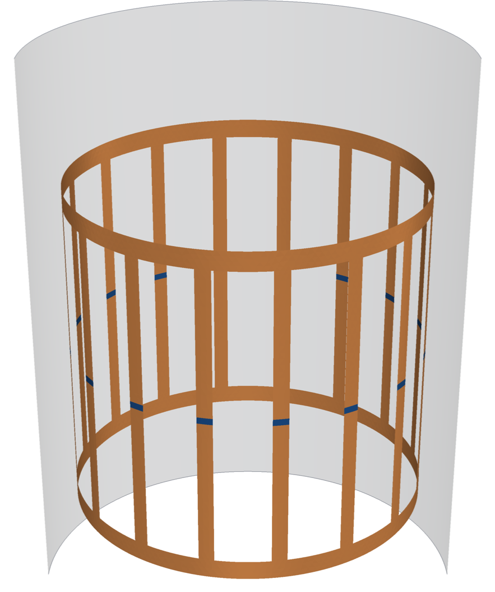

The default design is a 16-rung low-pass head coil (rung diameter 28 cm, 25 cm between end-ring centrelines,
RF shield 34 cm) tuned to the proton Larmor frequency at 3 T: 42.577 MHz/T x 3 T = 127.7 MHz.

> Not to be confused with **BirdcageBuilder** (Chin, Collins, Li, Dardzinski and Smith, Penn State, 2002), the
> well-known ladder-network design tool this project's analytic step follows. birdcage-palace adds a 3D
> full-wave eigenmode solve and automatic mode identification on top of that kind of model.

## Why the mode matters

A birdcage with N rungs is a periodic ladder network, so its resonances are discrete Fourier modes. In mode k the
rung currents go as I_n ∝ cos(2πkn/N + φ), k = 0 ... N/2 (Hayes et al. 1985; Tropp 1989; Leifer 1997):

* **k = 1** puts one full period of current around the coil, the 2D analogue of a cos θ surface current. It
  makes a uniform transverse B1 in the bore. It is a degenerate pair (cos and sin patterns, 90 degrees apart),
  so two drive ports 90 degrees apart in space and phase give a circularly polarised B1+ (quadrature drive).
* **k ≥ 2** modes have k current periods. Their field is a multipole that vanishes at the centre and is
  confined near the conductors. Every k between 1 and N/2 − 1 is a degenerate pair; k = N/2 is single.
* **k = 0** has the same current in every rung. In the low-pass coil that mode closes through the shield; in the
  high-pass coil the k = 0 modes are end-ring modes with no rung current (counter- and co-rotating ring currents).
* Where the capacitors sit sets the ordering. **Low-pass** (C in the rungs): k = 1 is the lowest resonance above
  DC and k = N/2 the highest. **High-pass** (C in the end-ring segments): the order flips, the end-ring k = 0 modes
  are on top and k = 1 is the highest rung mode below them. **Band-pass** has both.

So a full-wave solve returns a crowded spectrum (20 modes between 128 and 483 MHz for the tuned default coil), and
only one pair images. This tool finds that pair automatically.

## What it does

1. **Analytic first guess** (`birdcage_palace/ladder.py`). Neumann double integrals over the rung and ring
   centre lines, regularised with the geometric-mean distance of a thin strip, give the self and mutual
   inductances. The shield is represented by image conductors. Their discrete Fourier transforms Lleg_k and
   Lring_k give every mode frequency in closed form:
   low-pass ω_k² = 1 / (C (Lleg_k + Lring_k / (2 sin²(πk/N)))), high-pass ω_k² = 1 / (C (Lring_k + 2 sin²(πk/N) Lleg_k)),
   band-pass a combination of the two. The capacitor that puts k = 1 on the target frequency follows directly.
2. **Geometry and mesh** (`geometry.py`). The rungs and end rings are zero-thickness PEC strips on the coil
   cylinder. Each capacitor is a small patch across a 5 mm gap (in the rungs for low-pass, in the ring segments for
   high-pass, both for band-pass). The domain is the inside of the RF shield, closed by PEC end caps 10 cm beyond the
   rings. The mesh is graded to 5 mm on the strip edges and 2.5 mm at the gaps, and grows to 35 mm in the bore. An
   optional saline phantom (εr 78, σ 0.6 S/m) can be added.
3. **Palace eigenmode solve** (`palace.py`). Each capacitor is a Palace `LumpedPort` with only `C` set, so the
   capacitors enter the generalised eigenproblem. The solver is shift-and-invert Krylov-Schur (SLEPc) above a target
   of 0.55 f0, with 20 modes, order-2 Nédélec elements, and a direct MUMPS factorisation (`MGMaxLevels = 1`).
   The closed shield keeps the problem real and lossless, so unloaded Q is infinite by construction; a phantom or
   an absorbing boundary (`--shield 0` or `--shield-ends absorbing`) makes it complex and Palace reports Q.
4. **Mode identification** (`modes.py`). For every eigenmode:
   * the 16 capacitor currents (`port-I.csv`) give the rung-current pattern; its spatial DFT gives k and a purity;
   * about 4,000 field probes on the axial plane, the coronal plane and a 3D ROI (r < 0.6 R, |z| < L/6) give the
     ROI std/mean of |B_transverse| and the transverse fraction of |B|²;
   * modes whose capacitors carry almost no current are flagged as non-ladder resonances (end-ring / rung-half
     modes set by stray capacitance).

   The homogeneous pair is the k = 1 mode with a transverse field and the lowest ROI std/mean, plus its partner.
   The pair is then combined 90 degrees apart to give the quadrature B1+ and B1− maps.
5. **Retuning** (`birdcage tune`). The mesh is reused, only C changes. Because 1/f² = L_eff (C + C_stray) is
   linear in C, a secant step on 1/f² lands on target in one or two solves.

## Quick start

```bash
pip install -e .            # numpy, matplotlib, gmsh (+ pyvista for the 3D renders)
birdcage build --legs 16 --diameter 0.28 --length 0.25 --type lowpass --b0 3.0 --shield 0.34 --out runs/lp16
birdcage solve --case runs/lp16 --np 4      # Palace (on Windows it runs inside WSL; see below)
birdcage modes --case runs/lp16             # modes.json + figures in runs/lp16/figs
birdcage tune  --case runs/lp16 --tol 0.005 # rescale C until the k=1 pair is within 0.5 % of 127.7 MHz
```

`tune` starts from the plain (f/f0)² scaling, or from `--slope` (d(1/f²)/dC measured on a cheaper mesh), then takes
secant steps on 1/f². `tools/make_video.py`, `tools/export_docs.py` and `tools/hero.py` rebuild the clip, the
figures in `docs/img` and the hero image from a solved case.

`birdcage build --spec spec.json --out runs/x` takes the options from a JSON file (for example the builder's spec.json);
flags on the command line override it. `pip install git+https://github.com/benjhardy/birdcage-palace` installs the
`birdcage` command (or use `python -m birdcage_palace`).

`birdcage build --help` lists every option: rung and ring widths, gap, high-pass and band-pass, shield size and end
caps, phantom, mesh sizes and FE order. Palace is called as `run_palace config.json <np>` (a wrapper around the
Palace Apptainer image `palace -np <np> config.json`); `--palace-cmd "palace -np {np} {cfg}"` or the
`BIRDCAGE_PALACE_CMD` environment variable sets another launcher. On Windows the command runs inside WSL2.

## Results: default 16-rung low-pass head coil at 3 T

Simulation only. Coil: 16 rungs, 12 mm wide, on a 28 cm diameter, 25 cm between end-ring centrelines, 15 mm end
rings, one 5 mm capacitor gap at the middle of each rung, closed PEC shield 34 cm in diameter and 45 cm long, no load.
Numbers are in [`results/lp16_3T.json`](results/lp16_3T.json).

**The homogeneous mode**

| | |
|---|---|
| k = 1 pair | **127.73 MHz** (127.726 and 127.741 MHz; split 15 kHz, 0.012 %) |
| capacitor per rung | **1.83 pF** (ladder first guess 2.81 pF) |
| ROI std/mean of \|B_t\|, one linear mode | 4.0 % (ROI: r < 0.6 R, \|z\| < L/6) |
| quadrature B1+ (pair driven 90 degrees apart) | ROI std/mean 2.3 %, \|B1−\| / \|B1+\| = 4.0 % |
| transverse fraction of \|B\|² in the ROI | 0.997 |

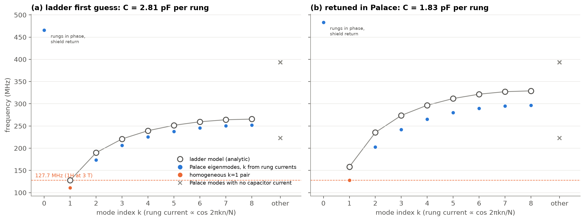

**Ladder model vs Palace** (same mesh, order 2, 1.12 M unknowns)

| k | ladder, C = 2.81 pF | Palace, C = 2.81 pF | ladder, C = 1.83 pF | Palace, C = 1.83 pF |
|---|---|---|---|---|
| 1 | **127.7** | 111.1 | 158.3 | **127.7** |
| 2 | 189.9 | 173.7 | 235.3 | 202.8 |
| 3 | 220.9 | 206.2 | 273.8 | 242.2 |
| 4 | 239.5 | 225.4 | 296.7 | 265.2 |
| 5 | 251.6 | 237.8 | 311.8 | 280.0 |
| 6 | 259.5 | 245.8 | 321.6 | 289.5 |
| 7 | 264.1 | 250.4 | 327.3 | 294.9 |
| 8 | 265.6 | 251.9 | 329.1 | 296.6 |

Frequencies in MHz; Palace pairs are averaged (the members agree to within 0.04 MHz). Palace also finds modes the
ladder model does not have: k = 0 with all rungs in phase, closing through the shield (465.7 MHz at 2.81 pF, 483.3 MHz
at 1.83 pF), and two pairs at 222.6 and 393.3 MHz whose capacitors carry about 0.1 % of the current of the ladder
modes. Those two pairs do not move when C changes, so they are resonances of the end rings and rung halves with
their stray capacitance, not birdcage modes.

At the first-guess capacitor Palace puts k = 1 13 % below the ladder value. Fitting 1/f² = L_eff (C + C_stray) to the
three fine-mesh solves gives L_eff = 511 nH, against 553 nH from the ladder model (most likely because of the shield
end caps, which the model leaves out and which lower the ring inductance), plus C_stray = 1.21 pF in parallel with each lumped capacitor, which is
two-thirds of its final value. At 3 T a 16-rung low-pass head coil needs only a couple of picofarads per rung, so the
distributed capacitance of the strips (to the shield and to each other) matters as much as the lumped part. This is the usual argument
for high-pass or band-pass designs at 3 T and above.

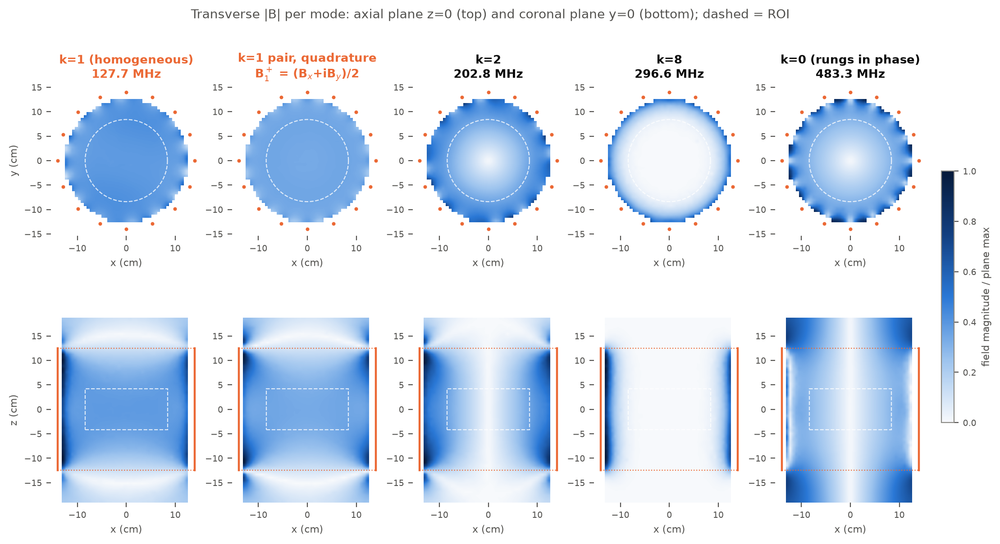

The maps show why the mode choice matters. Only k = 1 fills the ROI with a uniform transverse field (std/mean 4 %).
k = 2 has a null at the centre (35 %), k = 8 keeps its field at the conductors (126 %), and the in-phase k = 0 mode
gives an azimuthal field that vanishes on the axis (33 %).

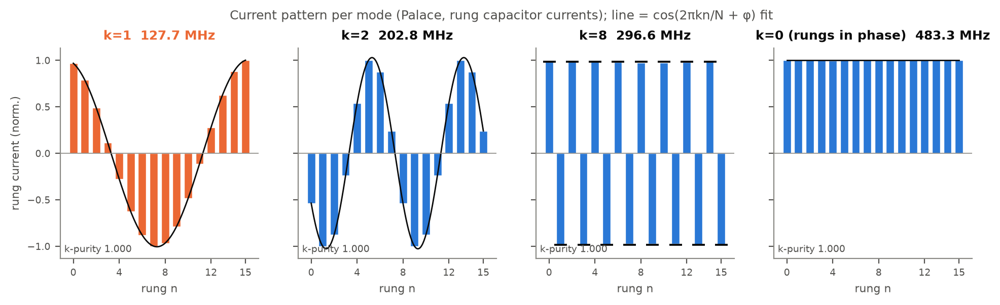

**Mesh convergence of the k = 1 frequency** (C = 2.81 pF)

| mesh (strip edge / gap / bore, mm) | tets | order | unknowns | k = 1 (MHz) | change | ranks | wall | peak RAM |
|---|---|---|---|---|---|---|---|---|
| 8 / 4 / 40 | 72 k | 1 | 92 k | 112.95 | | 4 | 3.0 min | 1.4 GB |
| 8 / 4 / 40 | 72 k | 2 | 484 k | 111.54 | −1.25 % | 4 | 6.6 min | 6.6 GB |
| 5 / 2.5 / 35 | 169 k | 2 | 1.12 M | 111.08 | −0.41 % | 4 | 20.4 min | 16.2 GB |

The last step moves k = 1 by 0.4 % and k = 8 by 0.7 %. The next refinement step of the full model would need more
RAM than the 32 GB machine used here has; the symmetry-plane models below go further and put the production k = 1
about 0.7 % above the converged value (the strip edges, not the bulk mesh, set the error). The
tuning steps on the production mesh took 14.2 and 13.6 min each (4 MPI ranks on an 8-thread machine that was at
times shared with another Palace job). Palace estimates the peak memory at 16.2 GB. Retuning took two solves: the first step used the 1/f² slope
from a pair of coarse solves and landed at +0.24 %, and a secant step then landed at +0.001 %.

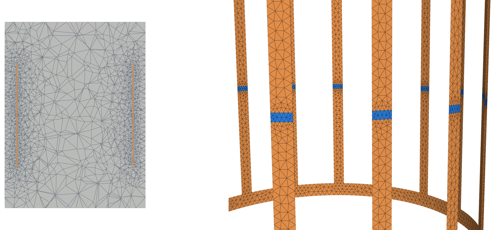

## Loaded check: saline phantom (coarse mesh)

A cylindrical phantom (radius 8 cm, length 20 cm, εr 78, σ 0.6 S/m) inside the tuned coil (C = 1.83 pF), on the
coarse order-2 mesh, compared with the same mesh unloaded:

| | unloaded | loaded |
|---|---|---|
| k = 1 pair | 128.09 MHz | 127.33 MHz (−0.6 %) |
| Q (phantom loss only; conductors are lossless) | ∞ | 66 |
| quadrature B1+, ROI std/mean | 2.4 % | 18 % |
| \|B1−\| / \|B1+\| in the ROI | 4.0 % | 28 % |
| solve | 484 k unknowns, 3.8 min on 4 ranks, 6.6 GB | 498 k unknowns, 5.4 min on 6 ranks, 7.9 GB |

The phantom makes the eigenproblem complex (Palace reports Q directly). At 128 MHz the wavelength in the phantom is
about 27 cm, comparable to its 16 cm diameter, so the quadrature field brightens at the centre and B1+ and B1−
separate. That is the familiar 3 T head-imaging inhomogeneity, which the empty-coil maps above do not show. The ROI
(r < 8.4 cm) extends 4 mm past the phantom radius. The loaded solve requested only the k = 1 pair (2 modes,
tolerance 1e-6); with 12 modes the quadratic eigenproblem converged too slowly to be practical here.

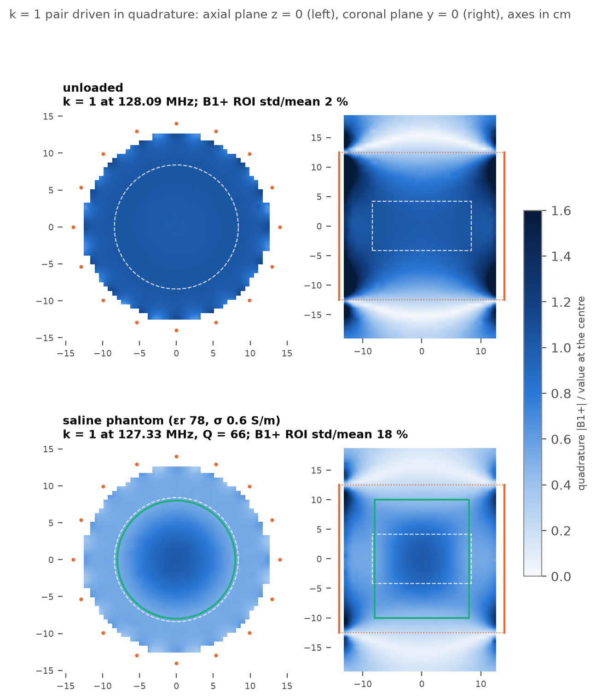

## With or without the shield

Simulation only. `birdcage build --shield 0` drops the RF shield: the coil then sits in an air cylinder closed by a
second-order absorbing boundary, the eigenproblem turns complex and Palace reports the radiation Q of each mode. The
builder page offers the choice in its last step: **with shield**, **without shield**, or **both**, which builds,
solves and tunes the two cases one after the other and then runs `birdcage compare`.

**Air box.** The boundary has to sit about a quarter wavelength out. The first rule (radius max(2R, R + 15 cm),
coil length + 60 cm, first order) put it 15 cm from the rungs and absorbed near field: the radiation Q came out four
times too low. Coarse mesh, order 1, C = 0.8807 pF, k = 1 pair
([`results/unshielded_airbox_check.json`](results/unshielded_airbox_check.json)):

| air cylinder, radius × length (m) | boundary order | k = 1 (MHz) | Q of k = 1 |
|---|---|---|---|
| 0.29 × 0.85 (first rule) | 1 | 127.35 / 127.53 | 17.8 |
| 0.45 × 1.15 | 1 | 128.99 / 129.35 | 39.6 |
| 0.70 × 1.65 | 1 | 128.99 / 129.11 | 68.4 |
| 1.00 × 2.25 | 1 | 128.82 / 129.01 | 78.1 |
| 0.45 × 1.15 | 2 | 129.71 / 130.07 | 43.3 |
| 0.70 × 1.65 | 2 | 129.11 / 129.23 | 80.9 |
| 0.73 × 1.42 (new default) | 2 | 129.21 / 129.38 | 81.1 |

The default is now a gap of max(15 cm, λ0/4) around the coil, radially and past each end ring (0.587 m at 3 T), a
second-order boundary, and a bulk mesh that grows from h_max to λ0/12 between 12 cm from the strips and the boundary,
so the larger box costs 102 k tetrahedra on the coarse preset instead of 89 k. `--air-radius` and `--air-length`
override it. With an absorbing boundary the solver asks for the k = 1 pair only (2 modes, tolerance 1e-6) and starts
its search at 0.75 f0: the boundary adds strongly damped box modes, and a 6-mode solve once spent 48 min on them after
it had found k = 1 in two restarts.

**Package test ("Both")**, from the page's zip in a fresh venv: 16-rung low-pass, 28 cm, 3 T, coarse mesh, order 1,
3 MPI ranks on a CPU shared with the loading sweep below; run.sh took 15.5 min in all
([`results/shield_compare_coarse.json`](results/shield_compare_coarse.json)):

| | with shield (34 cm can) | without shield |
|---|---|---|
| ladder first guess, C per rung | 2.807 pF | 1.804 pF |
| Palace k = 1 at the first guess | 112.98 MHz | 107.49 MHz |
| tuned C (3 solves each) | 1.8635 pF → 127.714 MHz | 0.9369 pF → 127.706 MHz |
| Q of k = 1 | ∞ (lossless conductors, closed can) | 83 (radiation) |
| quadrature B1+, ROI std/mean | 2.90 % | 2.44 % |
| Palace time per solve | 37 s (92 k unknowns) | 235–280 s (124 k unknowns, complex) |

Removing the shield at the shielded tuned C moves k = 1 from 127.71 to 106.43 MHz (−16.7 %, from the unshielded
1/f² vs C fit). The shield's image currents cancel part of the rung inductance, so the unshielded coil needs about
half the capacitance. The radiation Q of 83 is the empty coil's; a head-sized load (Q of about 60 from the phantom
alone, below) would dominate it.

## Phantom loading: conductivity vs permittivity

Simulation only. The tuned coil (C = 1.828 pF, **not retuned**) with a homogeneous cylindrical phantom on its axis,
length 20 cm, swept in conductivity and in permittivity. Plan, cost and actuals:
[`docs/loading-study.md`](docs/loading-study.md); numbers: [`results/loading_sweep.json`](results/loading_sweep.json).

**Model.** A centred cylinder keeps the coil's three mirror planes, so every case runs on the eighth model (production
mesh density, 20 mm in the phantom, order 2, 0.159 M unknowns), three Palace solves per case on one mesh per radius:
the k = 1 member with B1 along y (x = 0 PEC, y = 0 PMC, z = 0 PEC) with a lossless coil, which gives f and the
phantom-only Q; its partner (x = 0 PMC, y = 0 PEC), for the quadrature B1+ map; and the first member again with the
coil losses added (copper, 5.8e7 S/m, on the strips and the shield as a Palace `Conductivity` boundary, and 0.68 Ω
ESR per capacitor as the equivalent parallel R at f0), which gives Q_L. The same mesh with the phantom set to εr 1,
σ 0 is the empty coil: Q_U = 760 (ESR alone 1671, copper alone 1393). Q = Re f / (2 Im f). B1+ is normalised to a
mean of 1 µT over the ROI (r < 8.4 cm, |z| < 4.2 cm); |E| and the SAR-like σ|E|²/2 (W/m³, no tissue density) are
taken at the probes more than 3 mm inside the phantom.

**Checks** (saline, εr 78, σ 0.6 S/m, r 8 cm):

* *Loss tangent instead of conductivity.* tan δ = σ / (2π f0 ε0 εr) = 1.0825 gives 126.855 MHz, Q 65.8 against
  126.867 MHz, Q 66.8 with the conductivity (−0.009 %, −1.5 %). It was not faster on this model (150 s against
  105 s), so the sweep uses the conductivity.
* *Symmetry.* Quarter model (0.30 M unknowns, both members) against the eighth model: k = 1 126.886 / 126.877 against
  126.867 / 126.879 MHz, Q 66.76 / 66.84 against 66.80 / 66.82, B1+ ROI std/mean 17.93 against 17.96 %; the axial
  B1+ maps differ by 1.0 % RMS ([`results/loading_symmetry_check.json`](results/loading_symmetry_check.json)). The
  earlier full-model coarse loaded check (above) gave −0.6 %, Q 66 and 18 % too.
* *Losses add.* The full-loss solve gives Q_L = 60.89; 1/(1/66.80 + 1/760) = 61.4.

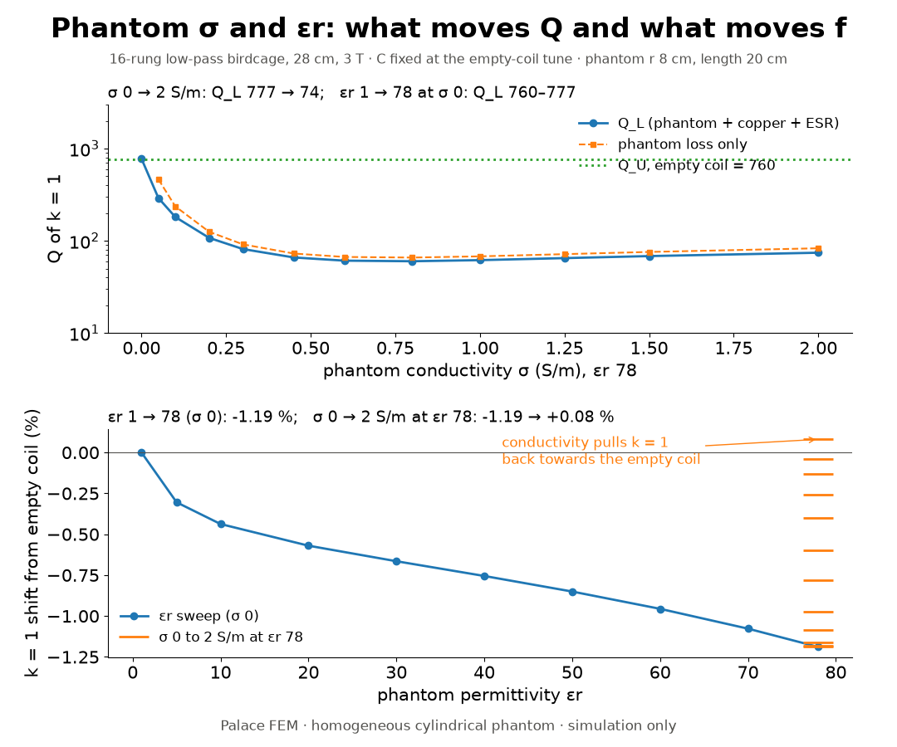

**Conductivity sweep** (εr 78, r 8 cm):

| σ (S/m) | k = 1 (MHz) | shift | Q, phantom only | Q_L | Q_U/Q_L | B1+ ROI std/mean | peak \|E\| (V/m) | peak σ\|E\|²/2 (W/m³) |
|---|---|---|---|---|---|---|---|---|
| 0 | 126.119 | −1.19 % | ∞ | 777 | 0.98 | 24.6 % | 55.5 | 0 |
| 0.05 | 126.127 | −1.18 % | 465 | 291 | 2.61 | 24.5 % | 55.5 | 77 |
| 0.1 | 126.153 | −1.16 % | 236 | 181 | 4.20 | 24.4 % | 55.5 | 154 |
| 0.2 | 126.250 | −1.09 % | 125 | 107.5 | 7.06 | 23.8 % | 55.4 | 307 |
| 0.3 | 126.391 | −0.98 % | 91.4 | 81.3 | 9.34 | 22.8 % | 55.2 | 458 |
| 0.45 | 126.638 | −0.78 % | 72.8 | 66.0 | 11.5 | 20.7 % | 54.9 | 678 |
| 0.6 | 126.873 | −0.60 % | 66.8 | 60.9 | 12.5 | 18.0 % | 54.5 | 890 |
| 0.8 | 127.126 | −0.40 % | 65.8 | 60.0 | 12.7 | 13.7 % | 53.8 | 1160 |
| 1.0 | 127.310 | −0.26 % | 67.8 | 61.7 | 12.3 | 9.6 % | 53.3 | 1419 |
| 1.25 | 127.472 | −0.13 % | 71.6 | 64.9 | 11.7 | 6.8 % | 52.7 | 1735 |
| 1.5 | 127.586 | −0.04 % | 75.7 | 68.3 | 11.1 | 9.1 % | 52.3 | 2053 |
| 2.0 | 127.739 | +0.08 % | 83.0 | 74.2 | 10.2 | 18.8 % | 52.1 | 2714 |

**Permittivity sweep** (σ 0, r 8 cm):

| εr | 1 | 5 | 10 | 20 | 30 | 40 | 50 | 60 | 70 | 78 |
|---|---|---|---|---|---|---|---|---|---|---|
| k = 1 (MHz) | 127.637 | 127.248 | 127.078 | 126.909 | 126.788 | 126.673 | 126.551 | 126.416 | 126.262 | 126.119 |
| shift | 0 | −0.30 % | −0.44 % | −0.57 % | −0.66 % | −0.76 % | −0.85 % | −0.96 % | −1.08 % | −1.19 % |
| Q_L | 760 | 760 | 761 | 762 | 763 | 765 | 767 | 770 | 773 | 777 |
| B1+ ROI std/mean | 2.3 % | 1.1 % | 1.8 % | 4.7 % | 7.9 % | 11.1 % | 14.5 % | 18.0 % | 21.6 % | 24.6 % |
| B1+ centre / ROI mean | 0.98 | 1.01 | 1.04 | 1.10 | 1.16 | 1.23 | 1.30 | 1.37 | 1.45 | 1.52 |

Conductivity only (εr 1, σ 0.6 S/m): 127.444 MHz (−0.15 %), Q_L 112.5, Q_U/Q_L 6.75, B1+ 5.3 %.

**Phantom radius** (εr 78, σ 0.6 S/m; each against its own empty mesh):

| radius (cm) | 5 | 6.5 | 8 | 9.5 | 11 |
|---|---|---|---|---|---|
| k = 1 shift | −0.16 % | −0.34 % | −0.60 % | −1.02 % | −2.06 % |
| Q_L | 283 | 124 | 60.9 | 35.2 | 23.1 |
| Q_U/Q_L | 2.67 | 6.10 | 12.5 | 21.5 | 32.7 |
| B1+ std/mean, z = 0 slice in the phantom | 7.8 % | 12.8 % | 18.3 % | 23.9 % | 29.8 % |

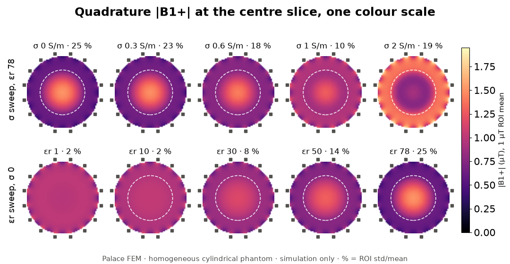

What the numbers say:

* **Q follows the conductivity.** Q_U/Q_L rises from 1 to 12.7 at σ = 0.8 S/m and then falls to 10.2 at 2 S/m: at
  2 S/m the skin depth in the phantom is about 3.6 cm, so less of the phantom carries current. A lossless phantom
  with εr 78 changes Q by +2 % (760 → 777). The phantom radius matters as much: Q_U/Q_L 2.7 at 5 cm, 33 at 11 cm.
* **The permittivity moves the frequency and the field shape.** εr 1 → 78 lowers k = 1 by 1.19 % and raises the
  B1+ std/mean from 2.3 to 24.6 % with the centre 1.52 times the ROI mean, the dielectric (standing-wave) brightening
  seen at 3 T.
* **The conductivity is not neutral for f and B1.** At εr 78 it pulls k = 1 back up (−1.19 % at σ 0, +0.08 % at
  2 S/m) and damps the centre brightening: the std/mean falls to 6.8 % at 1.25 S/m and rises again at 2 S/m, where
  the centre darkens (centre / mean 0.90).
* At 1 µT mean B1+, the peak |E| inside the phantom stays at 52–56 V/m across the conductivity sweep, so the
  SAR-like peak grows almost in proportion to σ.

Limits of this study: one homogeneous cylinder, no head model; the coil is not retuned or rematched; the quadrature
field is an ideal superposition of the two k = 1 eigenmodes, not a driven two-port solve; the copper loss of the
zero-thickness strips is an upper bound (Palace puts the strip current on one face), so Q_U is on the low side and
Q_U/Q_L on the high side; the production mesh is about 0.7 % high in frequency (see the symmetry section), which
applies equally to the loaded and empty cases.

`birdcage load` does the same for any tuned case whose mesh has a phantom region (`build --phantom
--phantom-eps 1 --phantom-sigma 0`, then tune, then `load --phantom-eps 78 --phantom-sigma 0.6`) and writes the shift,
Q_phantom, Q_U, Q_L and Q_U/Q_L into `tune_summary.json` under "loaded". Three solves: loaded with a lossless coil,
then loaded and empty with the coil losses (one mode near f0 each; on a symmetry model the quadrature map needs the
partner run). Run on the saline eighth case it reproduces
the sweep values (Q_U 759.5, Q_L 60.89, −0.60 %).

## High-pass check (coarse mesh, not tuned)

`birdcage build --type highpass` moves the capacitors into the 32 end-ring segments (ladder first guess 36.9 pF each).
One coarse solve (order 1, 100 k unknowns, 2.2 min on 3 ranks) shows the inverted spectrum the theory predicts:
k = 8 is now the lowest mode (58.5 MHz) and k = 1 the highest rung mode (135.2 MHz, ladder 127.7 MHz, ROI std/mean
3.6 %). Above it sit the two end-ring modes: co-rotating at 163.4 MHz (ladder 161.8 MHz; ring currents in the same
sense, axial field, transverse fraction 0.10) and counter-rotating at 163.7 MHz (ladder k = 0 at 155.7 MHz). The rung
modes and the counter-rotating mode are 5 to 13 % above the ladder values (the co-rotating mode 1 %). The shift has
the opposite sign to the low-pass coil: with 37 pF per gap the stray capacitance hardly matters, and the shield end caps, which the ladder model leaves out, probably lower the
inductance. This case is a functional
check on a coarse mesh only; it has not been retuned or refined.

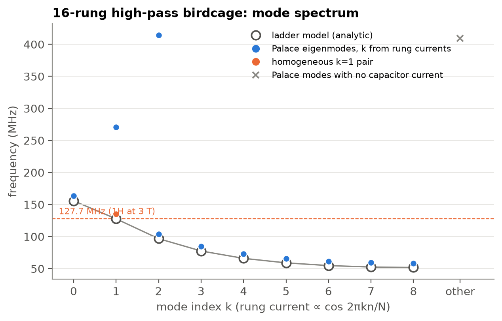


## Symmetry planes

Simulation only. The coil has the mirror symmetries of a square (16 rungs), so one linear member of the k = 1 pair can
be solved on a quarter of the domain, with a PEC wall on one cut plane and a PMC wall on the other. Same mesh density
as the production full model (5 / 2.5 / 35 mm, order 2), same capacitor (1.828 pF). Numbers are in
[`results/lp16_symmetry.json`](results/lp16_symmetry.json).

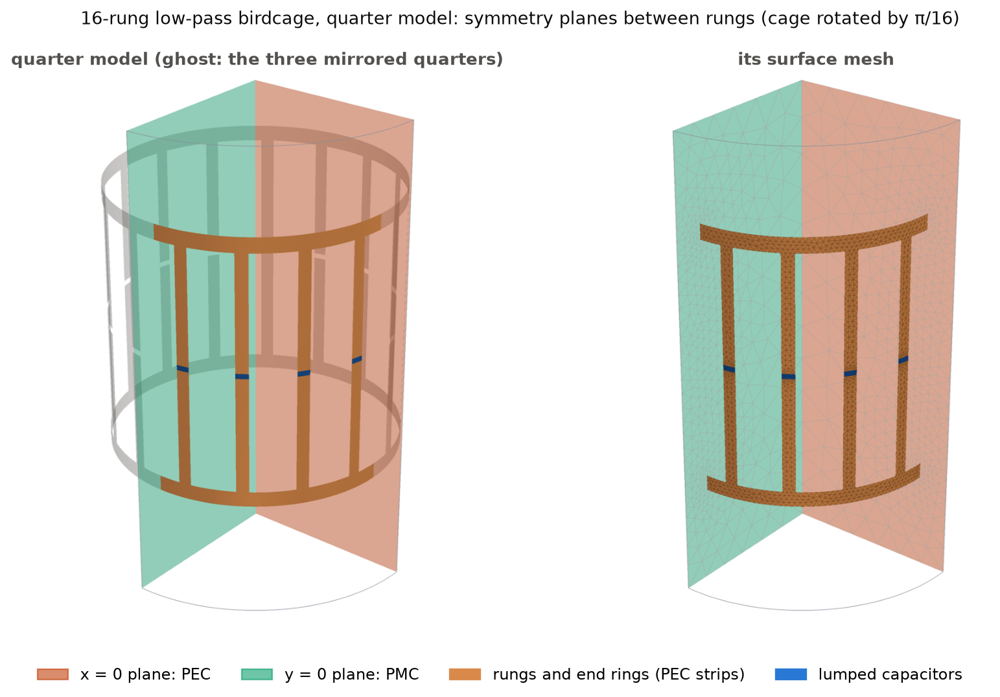

```bash
birdcage build ... --symmetry quarter --sym-bc x=pec,y=pmc --out runs/q_em   # B1 along y
birdcage variant --case runs/q_em --sym-bc x=pmc,y=pec --out runs/q_me        # same mesh, the partner (B1 along x)
birdcage solve --case runs/q_em && birdcage modes --case runs/q_em             # fields and rung currents unfolded to the full coil
```

**Which plane is which.** Take the member with rung currents I_n ∝ cos φ_n. A +z current at φ = 0 and a −z current at
φ = π both give B along −y at the centre, so this member's B1 is along y. Mirror it in the plane x = 0 (φ → π − φ):
cos changes sign, so the rung currents, which run parallel to that plane, are antisymmetric across it. The image of a
tangential current in a perfect electric conductor is reversed, so x = 0 is a **PEC plane** (tangential E = 0; B1
lies in it). Mirror it in y = 0 (φ → −φ): cos is unchanged, the currents are symmetric, and y = 0 is a **PMC plane**
(tangential H = 0; B1 crosses it at right angles). In short, the PEC plane contains B1 and the PMC plane is
perpendicular to it. The x-polarised member (sin φ_n) has the two swapped.

The full-model field confirms this. Rotating the solved pair so that one member has B1 along y and mirroring its ROI
field (938 point pairs per plane):

| member | plane | residual if PEC, \|B(Mr) − M B(r)\| / \|B\| | residual if PMC, \|B(Mr) + M B(r)\| / \|B\| | plane is |
|---|---|---|---|---|
| B1 along y | x = 0 | 0.66 % | 200 % | PEC |
| B1 along y | y = 0 | 200 % | 0.67 % | PMC |
| B1 along x | x = 0 | 200 % | 0.66 % | PMC |
| B1 along x | y = 0 | 0.65 % | 200 % | PEC |

Its rung currents fit −cos φ_n with a residual of 0.03 % (B along +y needs I ∝ −cos φ_n with this sign convention). In
Palace the PEC plane goes into `Boundaries.PEC`; the PMC plane is simply left without a boundary condition, because
PMC is the natural boundary of the curl-curl formulation (Palace says so in its log: "PMC/ZeroCharge condition is
assumed"). Fields and capacitor currents are unfolded to the full coil with the mirror rules B(Mr) = +M B(r) across a
PEC plane and −M B(r) across a PMC plane (rung current odd and even, respectively).

**Where the planes go.** With rungs at φ_n = 2πn/N the planes x = 0 and y = 0 pass through four rung centres, and
the plane cuts those rungs and their capacitors lengthwise. Palace defines a lumped element by its circuit value and
converts it to a per-square value with the element's own width and length, Cs = C · l / w. Half the width at the same
voltage carries half the current, so the half element needs **C / 2** (Cs is then unchanged; the Palace log shows
0.7616 pF/sq on every element). On a PEC plane the half rung is shorted by the wall and carries no current, which is
what the cos φ member has there anyway. Both versions were solved (quarter, x = 0 PEC, y = 0 PMC):

| quarter model | k = 1 (MHz) |
|---|---|
| planes between rungs (cage rotated by π/16) | 127.61 |
| planes through rungs, half element C / 2 | 127.70 |
| planes through rungs, full C on the half element (wrong) | 117.93 (−7.6 %) |
| full model, the pair | 127.73 (127.726 / 127.741) |

The default is **between rungs** (rotate the cage by π/N): no element is cut, each quarter holds four whole rungs with
the same C, and the z = 0 rule below is the only special case. It needs N divisible by 4.

**The z = 0 midplane (eighth model).** The capacitor gaps sit on it. In every ladder mode the rung current crosses
z = 0 and continues in the same direction, and the two end rings carry opposite currents, so the tangential E is odd
in z: z = 0 is a PEC plane. A PEC wall forces only the tangential E to zero; the gap field E_z is normal to the wall
and is allowed, so the capacitor is not shorted. The wall cuts the element across its length: each half sees half the
voltage at the full current, so the half element needs **2C** (again the same Cs). This is implemented
(`--symmetry eighth`). The z-even family, which a PMC wall at z = 0 would keep, has no voltage across the gaps; it
contains the 222 MHz pair whose capacitors carry no current, which the eighth model indeed no longer returns.

**Symmetry filters the spectrum.** A quarter model only supports modes with its own parities. For the rotated cage
(rungs at (2n+1)π/16) the four combinations split the 16 ladder modes into four families of four:

| x = 0 | y = 0 | rung currents | ladder modes kept | k = 1 | modes found below 490 MHz (MHz) |
|---|---|---|---|---|---|
| PEC | PMC | cos kφ, k odd | k = 1, 3, 5, 7 | B1 along y | 127.61, 222.46 (no cap. current), 242.07, 279.94, 294.84 |
| PMC | PEC | sin kφ, k odd | k = 1, 3, 5, 7 | B1 along x | 127.66, 222.51 (no cap. current), 242.07, 279.94, 294.70 |
| PMC | PMC | cos kφ, k even | k = 0, 2, 4, 6 | none | 202.72, 265.18, 289.46, 393.19 (no cap. current), 483.51 |
| PEC | PEC | sin kφ, k even | k = 2, 4, 6, 8 | none | 202.70, 265.13, 289.36, 296.51, 393.06 (no cap. current) |

(k = N/2 = 8 is a sine pattern on the rotated cage, cos 8φ_n = 0, so it appears only in PEC/PEC; k = 0 is a cosine
pattern.) The union of the four runs is exactly the full model's 20 modes: every one is matched by type and k, the
largest frequency difference is 0.11 %, and no run returns an extra mode below 490 MHz. A degenerate pair is split
across two runs, so the pair splitting itself (15 kHz in the full model, a mesh effect) needs both runs; on one
quarter mesh the two k = 1 members differ by 56 kHz (0.04 %), because that mesh is not symmetric about the diagonal.
For finding the imaging mode this filtering helps: in PEC/PMC the homogeneous mode is the lowest eigenvalue and only
four other modes lie below 300 MHz.

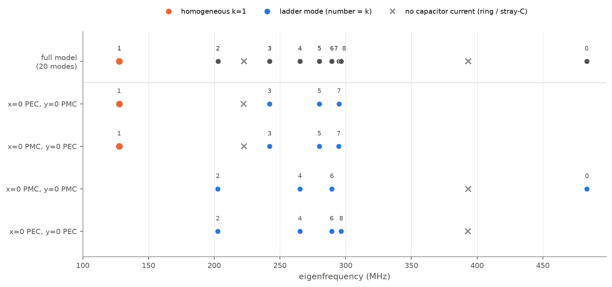

**Full vs quarter vs eighth** (same mesh density, order 2, C = 1.828 pF; MUMPS, 4 ranks):

| | full | quarter (x = 0 PEC, y = 0 PMC) | eighth (+ z = 0 PEC) |
|---|---|---|---|
| k = 1 (MHz) | 127.73 (pair mean) | 127.61 (−0.10 %) | 127.68 (−0.05 %) |
| ROI std/mean of \|B_t\|, linear member | 4.03 % | 4.04 % | 4.08 % |
| quadrature B1+, ROI std/mean | 2.35 % | 2.32 % (two quarter runs) | |
| tetrahedra | 169 k | 44 k | 23 k |
| unknowns | 1.12 M | 0.30 M (3.8×) | 0.16 M (7.2×) |
| peak memory (Palace estimate) | 16.6 GB | 3.7 GB (4.5×) | 2.1 GB (7.9×) |
| Palace time, whole run | 11.4 min (20 modes) | 2.2 min (20 modes, 5.3×); 1.2 min (10 modes) | 0.7 min (10 modes) |
| factorisation (setup + preconditioner) | 309 s | 25 s (12×) | 14 s (22×) |

The frequency differences are well inside the discretisation error of this mesh density (about 0.7 %, see below)
and are of the size one expects between two different meshes at that density. The factorisation row is the part of
the run that does not depend on the number of modes requested.
All four quarter runs (the whole spectrum, 10 modes each) take under 5 min against 11.4 min for one full run. All
timings in this table are from runs on a free machine (8 threads, 4 MPI ranks each); the full model was re-run for
this comparison (the production solves took 13.6–20.4 min while the machine was at times shared). Another Palace job shared
the machine during several of the other runs below; those times are marked.

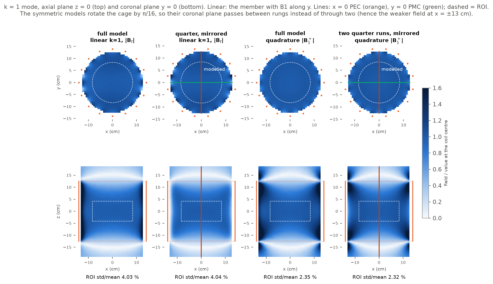

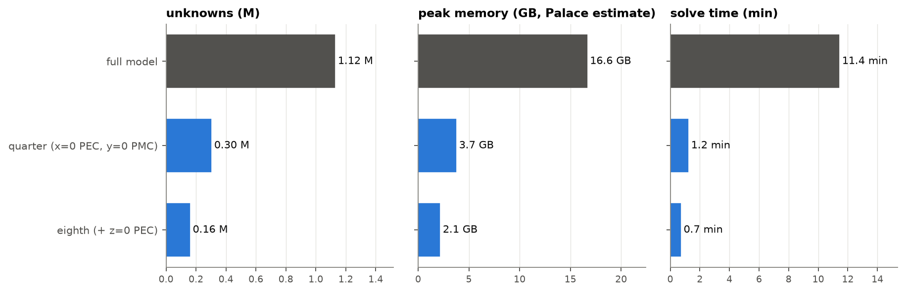

**Spending the savings: how converged is k = 1?** The eighth model makes meshes affordable that the full model cannot
reach on this machine: 1.0 M unknowns in the eighth correspond to about 8 M in the full coil. Seven eighth-model solves
(x = 0 PEC, y = 0 PMC, z = 0 PEC; C = 1.828 pF):

| mesh (strip edge / gap / bulk, mm) | order | unknowns (eighth) | k = 1 (MHz) | peak memory | Palace time |
|---|---|---|---|---|---|
| 5 / 2.5 / 35 (production density) | 2 | 0.16 M | 127.675 | 2.1 GB | 41 s |
| 3.5 / 1.75 / 25 | 2 | 0.37 M | 127.459 | 5.2 GB | 6.9 min, CPU shared |
| 2.5 / 1.25 / 18 | 2 | 0.90 M | 127.291 | 14.4 GB | 8.3 min |
| 2.5 / 1.25 / 35 | 2 | 0.42 M | 127.312 | 5.2 GB | 1.6 min |
| 1.25 / 0.625 / 35 | 2 | 1.01 M | 127.109 | 12.7 GB | 4.8 min |
| 5 / 2.5 / 35 | 3 | 0.45 M | 127.361 | 6.8 GB | 12.4 min, CPU shared |
| 4.2 / 2.1 / 30 | 3 | 0.67 M | 127.307 | 10.9 GB | 6.1 min |

Refining the bulk mesh (35 → 18 mm) moves k = 1 by only 0.02 MHz; refining the strip edges and gaps moves it by
0.36 MHz and then 0.20 MHz. The strips are zero-thickness PEC sheets, so the field is singular at their edges and the
error decays slowly, here as about h^0.84 (the asymptotic rate for such an edge is h^1). Richardson extrapolation of
the edge series gives a converged k = 1 of **126.85 MHz** with the observed rate (126.91 MHz with rate 1). The finest
run is 0.20 % above that, and the production mesh (127.73 MHz in the full model) is about **0.7 % high**: more than the
0.4 % estimated from the earlier two-step mesh study, because that study refined the whole mesh rather than the strip
edges. With the fitted 1/f² ∝ C + 1.21 pF, putting the converged k = 1 on 127.73 MHz would take roughly 1.79 pF
instead of 1.83 pF (an estimate; the stray capacitance also moves with the mesh). The ROI homogeneity does not change
with the mesh (4.01–4.08 % in all seven runs).

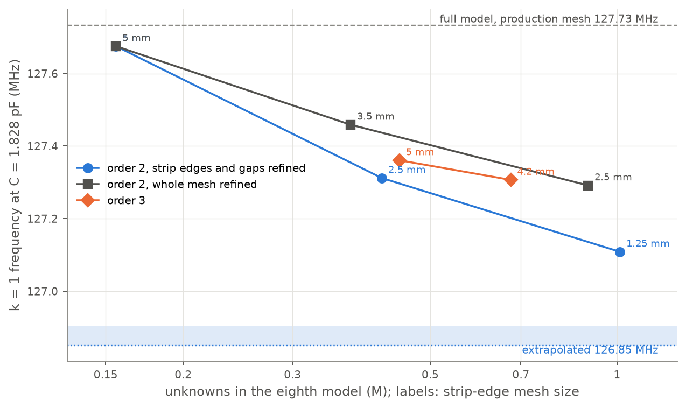

Clip: [`docs/img/birdcage_symmetry.mp4`](docs/img/birdcage_symmetry.mp4) (silent, 4:5, 34 s).

## Port tuning with circuitRF

Simulation only. The eigenmode loop above retunes C with a new full-wave solve per step. Port tuning moves that loop
into a circuit simulator: every capacitor gap becomes a port, Palace computes the multi-port S-matrix of the bare coil
once, and circuitRF (open source, run here through its headless CLI) closes the gaps with capacitors and adds the
drive network, so a capacitor change costs a circuit evaluation instead of a 3D solve.

```bash
birdcage portcase --case runs/e_em --sym-bc x=pec,y=pmc,z=pec --out runs/pt_e_em   # gaps -> 500 ohm ports, driven sweep
# ... the same for _me, _mm, _ee; then `birdcage solve` on each
python tools/port_tune.py assemble --cases runs/pt_e --out runs/pt_e/birdcage16.s16p --rotation-average
python tools/port_tune.py tune --snp runs/pt_e/birdcage16.s16p --name unloaded --esr 0.68 --band-khz 2 --iters 30
python tools/port_tune_figs.py --unloaded runs/pt_e/circuitrf/tune_unloaded.json --loaded runs/ptl_e/circuitrf/tune_loaded.json
```

**The EM step.** The 16 gaps are resistive lumped ports with a 500 Ω reference (close to the gap reactance at
128 MHz, which keeps S well conditioned), each port its own excitation, and Palace's adaptive fast sweep covers
100–160 MHz. The two drive ports are two of the same gaps (rungs 0 and 4, 90 degrees apart, as when a coil is fed at
a rung capacitor), so the Touchstone file is a 16-port (`.s16p`) rather than 16 + 2.

**Symmetry and multi-port excitation.** Driving one gap breaks every mirror symmetry, so a symmetry-reduced model
does not give an S-matrix column by itself. It helps once it is used explicitly: a quarter or eighth model with given
PEC/PMC walls computes the response to the symmetry-adapted excitation that drives a gap together with its mirror
images (signs from the rung-current parity), and character orthogonality inverts the four combinations into every
entry of the 16 × 16 matrix (`birdcage_palace/sparams.py`). The z = 0 wall is PEC in all four: the z-even family puts no
voltage across the gaps and does not couple to the ports. So the 16-port costs four eighth-model runs with four
excitations each (production mesh density, 0.16 M unknowns, 2.0–2.5 GB each; 33 min of Palace time for the four
unloaded runs and 85 min for the four loaded ones, on a CPU shared with another job). A full model with 16 excitations
at this density would be a complex 1.12 M-unknown system, about twice the 16.4 GB of the real eigenproblem, which is
more than this 32 GB machine has.

Checks: on a coarse mesh the rebuilt first column matches a direct full-model driven solve on all 16 ports to
\|ΔS\| < 4e-3 (\|S11\| ≈ 0.79; the meshes differ). On the production density, closing every gap of the 16-port with
1.828 pF puts the k = 1 pair at 127.670 / 127.674 MHz; eigen solves of the same eighth mesh give 127.671 / 127.675 MHz
(1 kHz apart). The rebuilt unloaded matrix is lossless to \|S S^H − I\| < 5.1e-5. The bare-coil S is smooth: the
adaptive sweep needed 4–5 full solves per excitation, and a cubic spline from the 2 MHz output grid is accurate to
about 1e-8.

**The circuit step** (circuitRF 1.0.9, `tools/port_tune.py`). Each gap gets its capacitor with an ESR of 0.68 Ω
(capacitor Q of about 1000 at 128 MHz; the conductors are lossless PEC, so without it the unloaded coil would have
nothing to match to). Each drive gap is a capacitive divider: the gap capacitor is split into a top capacitor Cd and a
tap capacitor Cp, and the 50 Ω port is connected across Cp through a series capacitor Cm. Goals at 127.73 MHz:
\|S11\|, \|S22\| ≤ −20 dB and \|S21\| ≤ −20 dB, over ±2 kHz unloaded and ±100 kHz loaded, minimax optimizer.

1. Resonance only: with every gap at the same C the S-matrix puts the k = 1 pair on 127.73 MHz at **1.825 pF**
   unloaded and 1.787 pF loaded. The eigenmode loop gave 1.828 pF on the full production mesh; this eighth mesh
   resonates 0.05 % lower at 1.828 pF, which accounts for the difference.
2. circuitRF on the rotation-averaged matrix (the exact 16-fold symmetry; averaging changes S by at most 4.5e-4):
   C on 12 rungs, a trim on rungs 2 and 10, and one divider (Cd, Cp, Cm) shared by both ports. Rungs 2 and 10 lie on
   the bisector of the two drive rungs, 45 degrees from both, so their C couples the two k = 1 members; the drive gaps
   also couple weakly through the other modes (a mutual reactance of about −10 Ω on the coarse mesh), and this trim
   cancels it.
3. circuitRF on the matrix as solved, where the mesh splits the k = 1 pair by 3.8 kHz: each port gets its own
   divider (per-port trims), starting from step 2. Unloaded the goals were already met; loaded the trims moved Cd by
   0.3 % and Cm by 8 % and improved the isolation from −20.2 to −22.6 dB.

| | unloaded (ESR 0.68 Ω) | loaded (saline phantom) |
|---|---|---|
| k = 1 with every gap at 1.828 pF (from the 16-port) | 127.670 / 127.674 MHz | 126.871 / 126.883 MHz |
| every gap equal, C for 127.73 MHz | 1.825 pF | 1.787 pF |
| C on 12 rungs | **1.844 pF** | **1.632 pF** |
| C on rungs 2 and 10 (isolation) | 1.841 pF | 1.647 pF |
| drive gaps: Cd + Cp (series value) | 1.768 + 24.70 pF (1.650 pF) | 2.885 + 5.576 pF (1.901 pF); 2.894 at port 2 |
| series capacitor to the port, Cm | 20.6 pF | 139.5 / 128.6 pF |
| worst over the band: \|S11\|, \|S22\|, \|S21\| | −20.0, −20.9, −20.1 dB | −20.0, −20.0, −22.6 dB |
| circuitRF evaluations, step 2 + step 3 | 102 + 28 | 137 + 97 |
| k = 1 share of the rung-current power, quadrature drive | 0.990 | 0.923 |

The phantom lowers the k = 1 frequency by 0.6 % at fixed C, as the coarse loaded check above found, so the loaded
tune needs smaller capacitors. The last row is the fraction of the rung-current power in the k = 1 harmonic when the
two ports are driven 90 degrees apart (computed from the same 16-port). A first version fed each drive gap through a
single series capacitor straight across the gap capacitor. That also met all goals, but the loaded match needed
2.37 pF in series with 50 Ω across the drive gap, which loads those two rungs with more than twice the capacitance of the
others; the k = 1 share then fell to 0.78 (0.99 unloaded). The divider keeps the capacitance across every gap within
17 % of the others. circuitRF's response at the optimum agrees with an independent termination of the same 16-port
in numpy to 6e-5 in \|S\| unloaded and 2e-6 loaded.

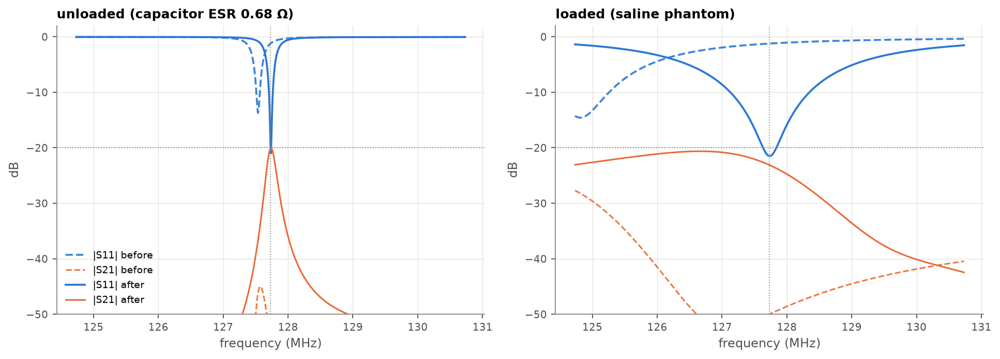

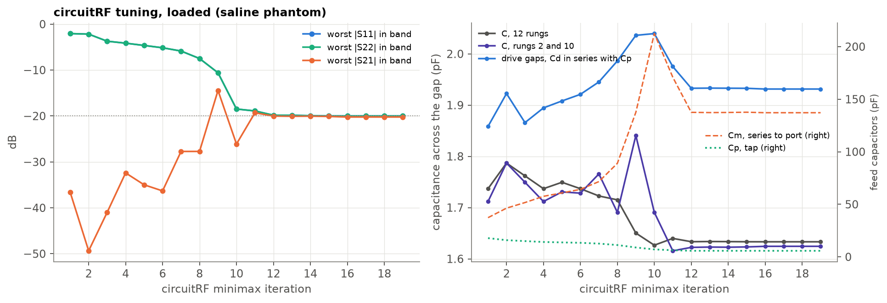

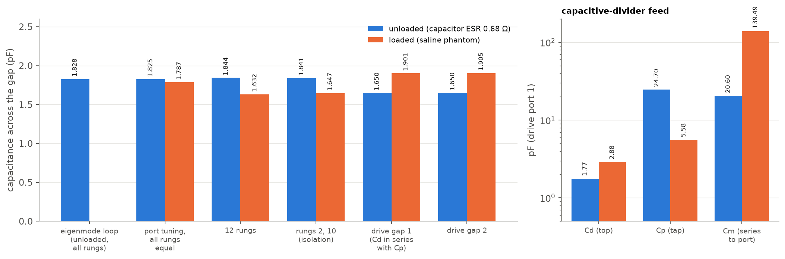

**Verification in Palace.** The tuned capacitors were put into a Palace eigen solve of the z ≥ 0 half of the coil
(`--symmetry zhalf`: all 16 rungs with the asymmetric tuned set, z = 0 PEC, 0.58 M unknowns, 7.2 GB, 2.3 min of Palace
time), with the feeds disconnected, so each drive gap holds Cd in series with Cp. The z-half mesh is not the eighth mesh
the 16-port came from, so the check is the shift from the same mesh with every gap at 1.828 pF:

| capacitors (unloaded) | Palace, z-half model | predicted from the 16-port | shift from uniform C: Palace / 16-port |
|---|---|---|---|
| every gap 1.828 pF | 127.737 / 127.747 MHz | 127.670 / 127.674 MHz | |
| divider tune (above) | 127.902 / 127.919 MHz | 127.831 / 127.851 MHz | +0.169 / +0.169 MHz |
| first tune (series-capacitor feed) | 129.340 / 129.352 MHz | 129.275 / 129.277 MHz | +1.604 / +1.604 MHz |

The 16-port predicts the shift caused by each tuned capacitor set to within 1 kHz; the 0.055 % offset at uniform C is
the difference between the two meshes. The feed-disconnected coil resonates above 127.73 MHz because the feed (Cm and
the 50 Ω source across the tap) adds capacitance; with it connected, circuitRF puts the match on 127.73 MHz. With the
divider-tuned capacitors the quadrature B1+ has an ROI std/mean of 2.36 %, against 2.33 % at uniform C.

Clip: [`docs/img/birdcage_porttune.mp4`](docs/img/birdcage_porttune.mp4) (silent, 4:5).

## Limits

* Simulation only; nothing here is measured. By default the conductors are lossless PEC sheets and the capacitors are
  ideal, so a shielded empty coil has no loss. `--copper-sigma` (Palace Conductivity boundary on strips and shield, an
  upper bound on the strip loss, see the loading study) and `--esr` add coil losses. Cables and baluns are not modelled. The port-tuning step adds an assumed capacitor ESR (0.68 Ω) and an ideal capacitive-divider feed in the circuit simulator; its ports are referenced individually across each gap (single-ended, no balun), and the drive network is a circuit model, not part of the 3D solve.
* Symmetry planes are implemented for the low-pass coil with a multiple of four rungs; the z = 0 plane must be PEC.
  The S-matrix assembly needs the planes between rungs.
* The shield is a closed PEC can (end caps 10 cm beyond the rings), not the open-ended shield of a real scanner. It
  probably lowers the ring inductance a little. `--shield 0` (absorbing outer boundary) was tested on the coarse mesh
  (section above); `--shield-ends absorbing` is implemented but untested. Both turn the eigenproblem complex.
* The quadrature B1+ map is a superposition of the two k = 1 eigenmodes, which is what an ideal, decoupled
  quadrature drive excites at resonance. It is not a driven two-port solve.
* The ladder model is quasi-static and ignores stray capacitance. It is a starting point, not the answer.
* Only the low-pass coil has been taken through mesh refinement. The high-pass and band-pass (ratio 1) coils were tuned
  on the production mesh ([`results/hp16_3T.json`](results/hp16_3T.json): 37.80 pF per ring gap, k = 1 at 127.73 MHz,
  ladder first guess 36.88 pF; [`results/bp16_3T.json`](results/bp16_3T.json): 41.23 pF in every gap, 127.66 MHz, ladder
  first guess 39.68 pF) but not refined further.

## References

1. C. E. Hayes, W. A. Edelstein, J. F. Schenck, O. M. Mueller, M. Eash, "An efficient, highly homogeneous
   radiofrequency coil for whole-body NMR imaging at 1.5 T," *J. Magn. Reson.* 63, 622–628 (1985).
2. J. Tropp, "The theory of the bird-cage resonator," *J. Magn. Reson.* 82, 51–62 (1989).
3. M. C. Leifer, "Resonant modes of the birdcage coil," *J. Magn. Reson.* 124, 51–60 (1997).
4. C.-L. Chin, C. M. Collins, S. Li, B. J. Dardzinski, M. B. Smith, "BirdcageBuilder: design of specified-geometry
   birdcage coils with desired current pattern and resonant frequency," *Concepts Magn. Reson.* 15(2), 156–163 (2002),
   doi:10.1002/cmr.10030.
5. J. Jin, *Electromagnetic Analysis and Design in Magnetic Resonance Imaging*, CRC Press (1998).
6. F. W. Grover, *Inductance Calculations*, Van Nostrand (1946) (strip self-inductance, geometric mean distance).
7. Palace: 3D finite element solver for computational electromagnetics, AWS Labs, https://github.com/awslabs/palace (version 0.16 used here).
8. C. Geuzaine, J.-F. Remacle, "Gmsh: a 3-D finite element mesh generator with built-in pre- and post-processing
   facilities," *Int. J. Numer. Meth. Eng.* 79(11), 1309–1331 (2009).

## License

MIT. Palace (Apache-2.0) and Gmsh (GPL) are used as external tools and are not redistributed here.
