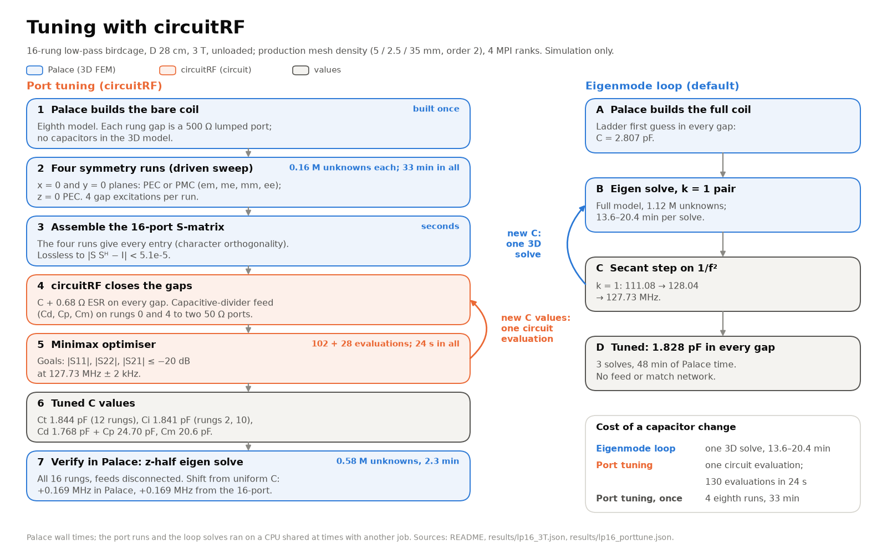
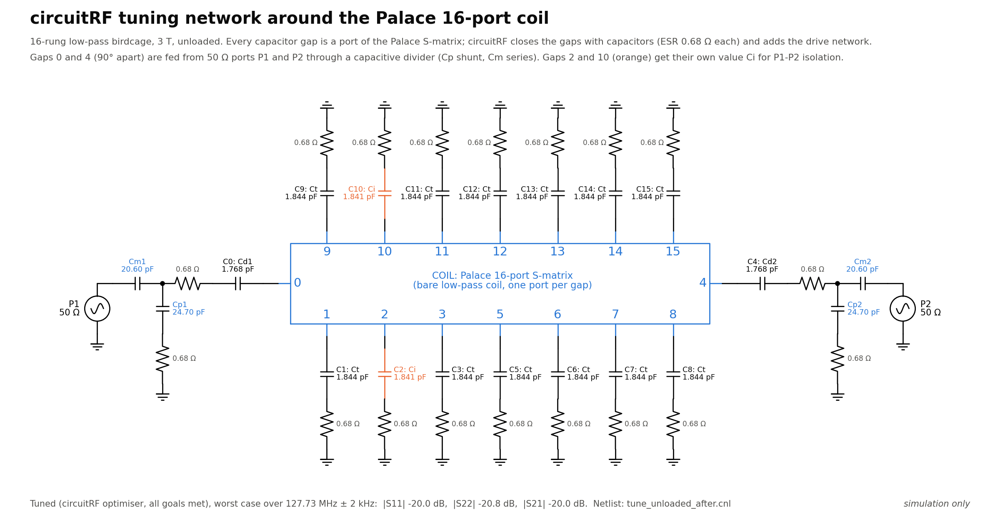

# Port tuning with circuitRF: step by step

Simulation only. This guide takes a low-pass birdcage from a bare 3D model to tuned capacitors and a matched,
decoupled quadrature feed. Palace computes the multi-port S-matrix of the coil once (every capacitor gap is a port);
circuitRF then closes the gaps with capacitors, adds the drive network and optimises it. A capacitor change costs a
circuit evaluation, not a 3D solve. The background and the results for the 16-rung reference coil are in the README,
section [Port tuning with circuitRF](../README.md#port-tuning-with-circuitrf).



Contents: [cost and time](#cost-and-time) · [limits](#limits) · [0 prerequisites](#0-prerequisites) ·
[1 build](#1-build-the-coil-eighth-model) · [2 port cases](#2-make-the-four-port-cases) · [3 solve](#3-solve-the-four-port-cases) ·
[4 assemble](#4-assemble-the-16-port-s-matrix) · [5 resonance](#5-check-the-resonance) · [6 tune](#6-run-the-tuner) ·
[7 outputs](#7-read-the-outputs) · [8 edit the netlist](#8-open-and-edit-the-netlist-by-hand) ·
[9 verify](#9-verify-in-palace-z-half-eigen-solve) · [your own coil](#your-own-coil) · [troubleshooting](#troubleshooting)

## Cost and time

Reference coil: 16-rung low-pass, D 28 cm, L 25 cm, 34 cm closed shield, 3 T, unloaded, production mesh density
(5 / 2.5 / 35 mm, order 2), MUMPS direct solver, 4 MPI ranks on an 8-thread, 32 GB machine. Numbers from the README.

| step | what runs | size | time |
|---|---|---|---|
| 1 build | Gmsh, eighth model | 23 k tetrahedra | seconds |
| 2 port cases | file copies | | seconds |
| 3 solve | Palace driven sweep, 4 runs × 4 excitations | 0.16 M unknowns, 2.0–2.5 GB each | 33 min for all four (CPU shared with another job) |
| 4 assemble | numpy | 16 × 16 × 31 frequencies | seconds |
| 5 resonance | numpy | | seconds |
| 6 tune | circuitRF `opt` (2 runs) and `sparam` (2 sweeps) | 102 + 28 evaluations | 24 s in all |
| 9 verify | Palace eigen, z-half model, 2 solves | 0.58 M unknowns, 7.2 GB | 2.3 min each |

For comparison, the eigenmode loop solves the full coil (1.12 M unknowns, 16.6 GB) once per capacitor change:
13.6–20.4 min per solve, 3 solves (48 min) from the ladder first guess to 127.73 MHz, and it has no feed network.
The loaded case (saline phantom) took 85 min for the four port runs, again on a shared CPU.

A smaller example, run end to end from the builder package (see [your own coil](#your-own-coil)): 12 rungs, D 24 cm,
coarse mesh, order 2. Each port run had 60 k unknowns and took 21–24 s; the whole script took 224 s.

## Limits

- Low-pass coil only: the ports are the rung gaps, and the symmetry assembly is written for them.
- A multiple of 4 rungs, with the symmetry planes between rungs (`--sym-cut between`, the default; the cage is rotated
  by π/N). Planes through rungs cut a gap in half and the assembly refuses them.
- The z = 0 plane is PEC in all four runs. The z-even modes put no voltage across the gaps and do not couple to the ports.
- The strips and shield are lossless PEC; the assumed capacitor ESR (0.68 Ω, Q ≈ 1000 at 128 MHz) is the only coil loss.
  The ports are single-ended across each gap (no balun, no cable). The drive network is a circuit model, not part of the
  3D solve.
- The builder package runs the shielded, empty coil. A loaded port tune (phantom in the four port runs) works the same
  way, but the resonance check (step 5) needs a lossless matrix, and the band in step 6 must be wider (±100 kHz was
  used); see the README.

## 0. Prerequisites

Tested on Ubuntu 24.04 in WSL2 (Windows 11) and natively from inside it.

**Palace** 0.16 or newer: https://awslabs.github.io/palace/stable/install/. birdcage-palace calls
`run_palace {cfg} {np}` by default; set another launcher with `--palace-cmd` or `BIRDCAGE_PALACE_CMD`, e.g.

```bash
export BIRDCAGE_PALACE_CMD="palace -np {np} {cfg}"                          # Spack install, palace on the PATH
export BIRDCAGE_PALACE_CMD="apptainer run /path/to/palace.sif -np {np} {cfg}"  # Apptainer image
```

**Gmsh** comes with birdcage-palace (the `gmsh` wheel from pip). Headless Linux still needs a few libraries:

```bash
sudo apt install python3-venv git libglu1-mesa libxcursor1 libxft2 libxinerama1
```

**birdcage-palace** (numpy, scipy, matplotlib, gmsh):

```bash
python3 -m venv ~/.venvs/birdcage-palace && . ~/.venvs/birdcage-palace/bin/activate
pip install "git+https://github.com/benjhardy/birdcage-palace"
birdcage --version
```

**circuitRF** 1.0.9. Source and releases: https://github.com/potatobeanradio/circuitRF (MIT licence, copyright
potatobeanradio). Newer releases exist (1.5.0 on 23 Oct 2026); everything here was run with 1.0.9. The Linux x64
tarball (105,585,122 bytes) has its own installer that writes only under `$HOME`, without root:

```bash
mkdir -p ~/src/circuitrf && cd ~/src/circuitrf
curl -LO https://github.com/potatobeanradio/circuitRF/releases/download/1.0.9/circuitRF-1.0.9-linux-x64.tar.gz
echo "1f5c6012a31343acae8948b0b2cecbf43081bcc6ce8e98c87b64deccdef8a3fb  circuitRF-1.0.9-linux-x64.tar.gz" | sha256sum -c -
tar xzf circuitRF-1.0.9-linux-x64.tar.gz
cd circuitRF-1.0.9 && ./install.sh
timeout 60 ~/.local/share/circuitRF/current/circuitRF --version     # prints 1.0.9
```

(The checksum is that of the 1.0.9 tarball used for the results here.) `install.sh` creates:

| path | what |
|---|---|
| `~/.local/share/circuitRF/app-1.0.9/` | the application: the `circuitRF` executable, `LICENSE`, `THIRD-PARTY-NOTICES.md`, `docs/`, `examples/` |
| `~/.local/share/circuitRF/current` | symlink to `app-1.0.9`; the stable launch path |
| `~/.local/bin/circuitrf` | launcher script (lower case) that runs `current/circuitRF` |
| `~/.local/share/applications/circuitrf.desktop` | desktop menu entry |

If `~/.local/bin` is not on the PATH, the installer says so; add `export PATH="$HOME/.local/bin:$PATH"` to
`~/.profile`. Uninstall with `~/.local/share/circuitRF/install.sh --uninstall`. The desktop app can update itself in
the background (Settings has a checkbox to turn that off); check `circuitRF --version` if results change.

Notes on the 1.0.9 command line:

- `circuitRF --help` and `circuitRF help` start the GUI (Avalonia). In WSLg a window opens and the command waits; on a
  machine without a display it aborts with `XOpenDisplay failed`. Use `--version`, and read the CLI reference in
  `~/.local/share/circuitRF/current/docs/user/reference/cli.html` (also `netlist.html` and `optimization.html`).
- It is a self-contained .NET program. On a minimal Linux without ICU it may fail at start; install `libicu74`
  (Ubuntu 24.04) or your distribution's libicu.

**How birdcage-palace finds circuitRF**: `--crf PATH`, else the `BIRDCAGE_CIRCUITRF` environment variable, else
`circuitRF` or `circuitrf` on the PATH, else `~/.local/share/circuitRF/current/circuitRF`. On Linux it runs natively.
On Windows (birdcage-palace in a Windows Python) every circuitRF call goes through `wsl.exe` into the default WSL
distribution; `--wsl-distro NAME` or `BIRDCAGE_WSL_DISTRO=NAME` picks another one. Palace follows the same rule
(`birdcage solve --wsl-distro`).

## 1. Build the coil (eighth model)

```bash
birdcage build --legs 16 --diameter 0.28 --length 0.25 --type lowpass --b0 3.0 --shield 0.34 \
    --symmetry eighth --sym-bc x=pec,y=pmc,z=pec --modes 10 --out runs/pt_e_base
```

This writes the Gmsh mesh of one eighth of the coil (x ≥ 0, y ≥ 0, z ≥ 0) with the ladder first-guess capacitor, and
an eigenmode config that this guide does not use. The planes sit between rungs, so the quarter holds 16 / 4 = 4 whole
rungs, and the z = 0 plane cuts each rung gap in half (the gaps sit on z = 0). The capacitor value does not enter the
port runs; it is kept as the reference C for step 6 (`--c-leg 1.8278810808e-12` reproduces the README, where the
reference is the eigenmode-loop result). Mesh options (`--h-coil`, `--h-gap`, `--h-max`, `--order`) are those of any
build; `birdcage build --help` lists them.

## 2. Make the four port cases

Each command copies the mesh and writes a Palace driven-sweep config in which every rung gap is a resistive lumped
port (500 Ω reference, each port its own excitation, no capacitors). The two letters are the conditions on the planes
x = 0 and y = 0 (e = PEC, m = PMC); z = 0 is PEC in all four.

```bash
birdcage portcase --case runs/pt_e_base --sym-bc x=pec,y=pmc,z=pec --out runs/pt_e_em
birdcage portcase --case runs/pt_e_base --sym-bc x=pmc,y=pec,z=pec --out runs/pt_e_me
birdcage portcase --case runs/pt_e_base --sym-bc x=pmc,y=pmc,z=pec --out runs/pt_e_mm
birdcage portcase --case runs/pt_e_base --sym-bc x=pec,y=pec,z=pec --out runs/pt_e_ee
```

The sweep is 100–160 MHz in 2 MHz steps at 3 T and scales with B0 (`--fmin`, `--fmax`, `--fstep` in MHz override
it); Palace's adaptive fast sweep needed 4–5 full solves per excitation. A half gap on the z = 0 plane gets half the
reference resistance, so the per-square value matches the full gap. `--r-ref` changes the 500 Ω reference (close to
the gap reactance at 128 MHz, which keeps S well conditioned).

## 3. Solve the four port cases

```bash
birdcage solve --case runs/pt_e_em --np 4
birdcage solve --case runs/pt_e_me --np 4
birdcage solve --case runs/pt_e_mm --np 4
birdcage solve --case runs/pt_e_ee --np 4
```

Each run writes `postpro/port-S.csv` (|S| in dB and the phase for every port pair) and `solve_stats.json` (unknowns,
wall time, peak memory per rank if GNU time is installed). The config uses MUMPS with `"MGMaxLevels": 1`; keep it.
Run Palace in the foreground, so that stopping the command stops the solver.

## 4. Assemble the 16-port S-matrix

```bash
birdcage porttune assemble --cases runs/pt_e --out runs/pt_e/birdcage16.s16p --rotation-average
```

`--cases` is the common prefix of the four case folders. A reduced model with given PEC/PMC walls computes the
response to a symmetry-adapted excitation (a gap driven together with its mirror images, signs from the rung-current
parity); character orthogonality inverts the four into every entry of the full matrix (`birdcage_palace/sparams.py`).
Outputs, all in `runs/pt_e/`:

| file | contents |
|---|---|
| `birdcage16.s16p` | Touchstone v1, RI, Hz, 500 Ω; port n is the gap of rung n, rung 0 at 11.25° (π/16) |
| `birdcage16_sym.s16p` | the same averaged over the 16 rotations (the exact symmetry; the mesh splits each pair slightly) |
| `birdcage16.json` | N, rung angle, reference R, f0, the build C, the mesh, the sweep and the solve stats |

It prints the largest change made by the rotation average and the lossless check max |S Sᴴ − I| (README: 4.5e-4 and
5.1e-5). Check against a full-model driven solve with `birdcage porttune check --cases <prefix> --full <full case>`
(coarse mesh: |ΔS| < 4e-3 on the first column).

## 5. Check the resonance

```bash
birdcage porttune resonance --snp runs/pt_e/birdcage16.s16p
```

With one capacitor on every gap the coil resonates where an eigenvalue of the gap susceptance Im(Y + jωC) crosses
zero. The command prints the k = 1 pair at the build C, the single C that puts k = 1 on f0 (secant on 1/f², started
from the k = 1 projection of the gap admittance) and every resonance in the sweep band at that C. Reference coil:
1.828 pF gives 127.670 / 127.674 MHz (eigen solves of the same eighth mesh: 127.671 / 127.675 MHz) and 1.825 pF puts
the pair on 127.73 MHz. `--c 1.9e-12` asks for another C. The result is also written to `birdcage16_resonance.json`.

If the k = 1 pair at the build C is far from f0, that is the ladder model's error, not a problem: the tuner starts
from the C this step finds.

## 6. Run the tuner

```bash
birdcage porttune tune --snp runs/pt_e/birdcage16.s16p --name unloaded --esr 0.68 --band-khz 2
```

It runs in `runs/pt_e/circuitrf/` (`--work` to change it) and calls circuitRF four times:

1. `circuitRF opt tune_unloaded_sym.cnl --json`: the rotation-averaged matrix. Free values: Ct (most rungs), Ci (the
   isolation rungs), and one divider shared by both ports (Cd, Cp, Cm). Start: every gap at the step 5 C, Cp = 20 pF,
   Cm = 30 pF.
2. `circuitRF opt tune_unloaded.cnl --json`: the matrix as solved, from the step 1 result; each port now has its own
   Cd, Cp and Cm.
3. `circuitRF sparam` on `tune_unloaded_before.cnl` (every gap at the build C, the tuned feed) and
   `tune_unloaded_after.cnl` (the tuned values), ±3 MHz around f0.

The isolation rungs are the ones on the bisector of the two drive rungs (45° from both) and their opposites: rungs 2
and 10 for 16 rungs (rungs 1, 2, 7 and 8 for 12). A common change there couples the two k = 1 members and cancels the
weak coupling of the drive gaps through the other modes. Options: `--esr` (Ω in series with every capacitor),
`--band-khz` (the goals hold over f0 ± band), `--b0`, `--c-ref` (reference C for the "before" sweep), `--iters N`
(also record the optimiser trajectory for the README figure), `--crf`, `--wsl-distro`. Tuned-value ranges scale with
the step 5 C (1–3 pF for Ct at 1.825 pF).

Reference coil output (unloaded, 0.68 Ω ESR): Ct 1.844 pF, Ci 1.841 pF, Cd 1.768 pF, Cp 24.70 pF, Cm 20.60 pF;
worst over 127.73 MHz ± 2 kHz |S11| −20.0 dB, |S22| −20.8 dB, |S21| −20.0 dB; 102 + 28 evaluations; k = 1 share of
the rung-current power with a quadrature drive 0.990. The command also terminates the 16-port in numpy and compares
with circuitRF's sweep (6e-5 here).

You can run this step without Palace: the README's matrices are in the repository.

```bash
mkdir -p runs/pt_repo && cp results/birdcage16_unloaded.s16p runs/pt_repo/birdcage16.s16p \
  && cp results/birdcage16_unloaded_sym.s16p runs/pt_repo/birdcage16_sym.s16p
birdcage porttune tune --snp runs/pt_repo/birdcage16.s16p --name unloaded --esr 0.68 --band-khz 2 --c-ref 1.8278810808e-12 --b0 3
```

## 7. Read the outputs

| file | contents |
|---|---|
| `circuitrf/tune_unloaded.json` | everything below, in one file |
| `.raw.vals` | the tuned values in F: Ct, Ci, Cd1/Cd2, Cp1/Cp2, Cm1/Cm2 |
| `.raw.goals` | per goal: met, worst value (dB), where (Hz), margin |
| `.raw.opt`, `.sym.opt` | circuitRF outcome (`goalsMet`), iterations, evaluations, best cost (0 = all goals met) |
| `.at_f0` | \|S11\|, \|S22\|, \|S21\| in dB at f0 |
| `.sweep_before`, `.sweep_after` | the circuitRF sweeps (f, \|S11\|, \|S22\|, \|S21\| in dB) |
| `.k1_at_c_eigen_hz`, `.c_resonance_only` | step 5 numbers |
| `.k1_content_quadrature` | k = 1 share of the rung-current power, ports driven 90° apart |
| `.k1_predicted_feeds_disconnected_hz` | k = 1 pair with the tuned capacitors and the feeds removed (for step 9) |
| `circuitrf/tune_unloaded.cnl` | the tuned netlist (values from step 1, `tune` lines, goals): step 8 |
| `circuitrf/tune_unloaded.opt.json` | circuitRF's own JSON report of step 2 (`.opt.err`: its progress lines) |
| `circuitrf/out_unloaded_before.s2p`, `out_unloaded_after.s2p` | the 2-port at the drive ports, 50 Ω |
| `c_rungs_unloaded.json` | C across each of the 16 gaps with the feeds disconnected (drive gaps: Cd in series with Cp) |

The two drive ports are the gaps of rungs 0 and N/4 (90° apart), so driving them 90° out of phase gives the
quadrature field. `tools/port_tune_figs.py` draws the README figures from the JSON files.

## 8. Open and edit the netlist by hand

`circuitrf/tune_unloaded.cnl` is plain text: one statement per line, `;` starts a comment, values may carry units
(the circuitRF reference is `docs/user/reference/netlist.html` in the install). The tuned values are in
`tune_unloaded_after.cnl` too; `tune_unloaded.cnl` holds the values step 1 found as its start, plus the `tune` and
`goal` lines. For the reference coil:



| line | meaning |
|---|---|
| `Resr = 0.68 Ohm` | a global variable: the ESR used by every `R:` below |
| `Ct = 1.843828 pF` ... `Cp2 = 24.712946 pF` | the capacitor values as global variables. `Cd2 = Cd1` (in the `_sym` netlist) ties two values |
| `SnP:COIL g0 g1 ... g15 NumPorts=16 File="birdcage16.s16p"` | the Palace 16-port. Port n is node gn against ground; the file is copied next to the netlist |
| `C:C1 g1 e1 C=Ct` and `R:RS1 e1 0 R=Resr` | gap 1 closed by Ct in series with the ESR. Rungs 2 and 10 use `C=Ci` |
| `C:C0 g0 e0 C=Cd1`, `R:RS0 e0 a1 R=Resr` | drive gap 0: top capacitor Cd1 to the tap node a1 |
| `C:CP1 a1 t1 C=Cp1`, `R:RP1 t1 0 R=Resr` | tap capacitor Cp1 from a1 to ground (the gap sees Cd1 in series with Cp1) |
| `C:CM1 a1 p1 C=Cm1` | series capacitor from the tap to the port |
| `Port:P1 p1 0 Num=1 Z=50 Ohm` | 50 Ω port 1 (port 2 is the same on gap 4, a2, p2) |
| `analysis SP1 type=sparam start=126.7324 stop=128.7324 step=0.002 Unit=MHz` | S-parameter sweep, f0 ± 1 MHz in 2 kHz steps |
| `tune Ct min=1 pF max=3 pF scale=lin opt=1` | Ct is a free variable in [1, 3] pF; `scale=log` for wide ranges; `opt=1` lets the optimiser move it |
| `goal match1 = dB(SP1.S(1,1)) analysis=SP1 over=freq lo=127.7304 MHz hi=127.7344 MHz le -20` | \|S11\| ≤ −20 dB over f0 ± 2 kHz (`le` = at most, `ge` = at least) |
| `goal isol = dB(SP1.S(2,1)) ... le -20` | isolation between the two ports |
| `optimize algorithm=minimax maxiter=300 seed=1` | minimax lowers the largest violation; same seed, same result |

Run it in that folder (in WSL from Windows: `wsl`, then `cd /mnt/c/...`):

```bash
cd runs/pt_e/circuitrf
C=~/.local/share/circuitRF/current/circuitRF                  # or: circuitrf
$C opt tune_unloaded.cnl                                     # table of variables and goals; exit 3 = a goal unmet
$C opt tune_unloaded.cnl --json > my.opt.json                # the same as JSON (what birdcage porttune reads)
$C opt tune_unloaded.cnl --show-iterations                   # one line per iteration on stderr
$C sparam tune_unloaded_after.cnl -o after.s2p               # the netlist's own sweep, Touchstone out
$C sparam tune_unloaded_after.cnl --set Ct=1.85pF -o ct185.s2p        # override one value
$C sparam tune_unloaded_after.cnl --freq 127MHz:128.5MHz:0.5MHz -o f.s2p   # another sweep
$C netlist tune_unloaded_after.cnl --to-schematic -o after.csch      # a drawn schematic to open in the GUI
```

`opt` never writes the values back into the netlist: copy the `best` values into the `Ct = ...` lines (or into
`tune_unloaded_after.cnl`) yourself. On the reference coil `opt tune_unloaded.cnl` takes about 2 s (28 evaluations).

Edits that work:

- **A goal.** Change `le -20` to `le -25` for a deeper match, or widen `lo=`/`hi=` for a wider band (it must stay
  inside the `analysis` sweep). Add a goal with the same syntax, for example
  `goal match1w = dB(SP1.S(1,1)) analysis=SP1 over=freq lo=127.6 MHz hi=127.9 MHz le -10`. Delete a goal line to drop it.
- **The ESR.** Change `Resr = 0.68 Ohm`. It is the only coil loss, so it sets the resistance the feed matches to:
  re-run `opt`. With `--esr` the tuner writes the new value into every netlist.
- **Fix a value.** Delete its `tune` line (or set `opt=0`): it keeps the value on its `=` line.
- **A range.** Widen `min`/`max` when circuitRF reports a value as railed (at its bound).
- **The drive network.** For a single series capacitor straight across the gap (the first version in the README),
  replace the four divider lines of a drive gap with `C:C0 g0 e0 C=Cd1`, `R:RS0 e0 0 R=Resr` and
  `C:CM1 g0 p1 C=Cm1`, and delete the `Cp1` lines. To feed other rungs, move the `Cd`/`CP`/`CM`/`Port` lines to
  those gap nodes; keep them 90° apart (N/4 rungs) for quadrature. In Python, `FEED = "series"` in
  `birdcage_palace/porttune.py` writes the series version.
- **One port only** (linear drive): delete `Port:P2` and its feed lines and the `match2`/`isol` goals.

Each change is a circuit re-run in seconds. Only a change of the coil itself (geometry, shield, phantom, mesh) needs
new Palace runs.

## 9. Verify in Palace (z-half eigen solve)

The z-half model keeps all 16 rungs (only the z = 0 plane, PEC), so it can take a different C on every gap. The
drive gaps hold Cd in series with Cp (feeds disconnected). Solve it once at one C on every gap and once with the tuned
set, on the same mesh, and compare the shift with what the 16-port predicts for the same capacitors (the meshes
differ, so compare shifts, not absolute frequencies):

```bash
birdcage build --legs 16 --diameter 0.28 --length 0.25 --type lowpass --b0 3.0 --shield 0.34 --c-leg 1.8278810808e-12 \
    --symmetry zhalf --modes 4 --out runs/pt_e_zref
birdcage variant --case runs/pt_e_zref --c-rungs runs/pt_e/c_rungs_unloaded.json --out runs/pt_e_ztuned
birdcage solve --case runs/pt_e_zref --np 4
birdcage modes --case runs/pt_e_zref --no-figs
birdcage solve --case runs/pt_e_ztuned --np 4
birdcage modes --case runs/pt_e_ztuned --no-figs
birdcage porttune verify --snp runs/pt_e/birdcage16.s16p --ref-case runs/pt_e_zref --tuned-case runs/pt_e_ztuned \
    --out runs/pt_e/verify.json
```

Reference coil (README): uniform 1.828 pF 127.737 / 127.747 MHz in Palace against 127.670 / 127.674 MHz from the
16-port; divider tune 127.902 / 127.919 against 127.831 / 127.851 MHz. Shift +0.169 MHz in both, within 1 kHz. The
feed-disconnected coil resonates above f0 because the feed (Cm and the 50 Ω source across the tap) adds capacitance;
with it connected, circuitRF puts the match on f0. Drop `--no-figs` to get the B1 maps (quadrature B1+ ROI std/mean
2.36 % with the tuned set against 2.33 % at uniform C).

## Your own coil

The [web builder](https://benjhardy.github.io/birdcage-builder/) writes all of the above for a low-pass coil with a
multiple of 4 rungs (Tuning method: circuitRF port tuning): `run.sh` checks for Palace and circuitRF
(`INSTALL_CIRCUITRF=1` runs the install lines above), then builds, makes and solves the four port cases, assembles,
checks the resonance, tunes and verifies. `STOP_AFTER=build|ports|assemble|tune` stops early; `SKIP_VERIFY=1` skips
step 9. `birdcage porttune` reads N, f0 and the build C from the `.json` next to the `.sNp`, so the commands are the
same for any N (a 12-rung coil gives `birdcage12.s12p`).

Package test, 23 Oct 2026, fresh venv in WSL: 12 rungs, D 24 cm, L 25 cm, 34 cm shield, 3 T, coarse mesh
(8 / 4 / 40 mm), order 2.

| | |
|---|---|
| ladder first guess | 3.254 pF; the 12-port puts k = 1 at 116.835 / 116.843 MHz (−8.5 %) |
| one C for f0 | 2.554 pF |
| tuned | Ct 2.592 pF (rungs 4, 5, 6, 9, 10, 11), Ci 2.593 pF (rungs 1, 2, 7, 8), Cd 2.475 pF, Cp 35.00 pF, Cm 20.23 pF |
| at 127.732 MHz | \|S11\| −28.5 dB, \|S22\| −26.8 dB, \|S21\| −38.4 dB (worst over ±2 kHz: −27.9, −25.2, −38.4 dB) |
| circuitRF | goals met, 92 + 1 evaluations; agrees with the numpy termination to 2e-7 |
| Palace z-half check | shift +11.013 MHz in Palace, +11.016 MHz from the 12-port (3.8 kHz apart) |
| cost | 4 port runs of 60 k unknowns, 21–24 s each; z-half 218 k unknowns, 44–49 s per solve; 224 s in all |

## Troubleshooting

| symptom | cause and fix |
|---|---|
| `circuitRF --help` hangs, or aborts with `XOpenDisplay failed` | in 1.0.9 help starts the GUI. Use `--version` and the HTML docs; wrap calls in `timeout` |
| `circuitRF not found` | install it (step 0), or pass `--crf /path/to/circuitRF` or set `BIRDCAGE_CIRCUITRF` |
| from Windows: `There is no distribution with the supplied name` | `--wsl-distro` / `BIRDCAGE_WSL_DISTRO` must match `wsl --list --verbose`; leave it unset for the default distribution |
| Git Bash turns `/mnt/c/...` into `C:/Program Files/Git/mnt/c/...` | prefix the command with `MSYS_NO_PATHCONV=1` |
| `not solved yet (no postpro/port-S.csv)` | a port case has not been solved, or Palace failed: read its `palace.log` |
| `assembly needs the planes between rungs` | rebuild with `--sym-cut between` (the default) and a multiple of 4 rungs |
| `frequency grids differ between the combinations` | the four cases need the same `--fmin/--fmax/--fstep`; re-run `portcase` with the same values |
| `no resonance in the band` in step 5 | k = 1 lies outside the sweep: widen `--fmin/--fmax` in step 2 and re-solve. A lossy (loaded) matrix has no clean crossing: skip step 5; `tune` falls back to the k = 1 projection |
| an outcome other than `goalsMet` (exit code 3 from `opt`) | read `.raw.goals`: a value at its bound is railed (widen the `tune` range), or the band is too wide for the coil Q (a 0.68 Ω ESR gives Q ≈ 1000; ±2 kHz unloaded, ±100 kHz loaded worked) |
| `gave no JSON` | circuitRF failed before it printed a result; its stderr is in the error message and in `*.opt.err` |
| a solve is slow or runs out of memory | keep MUMPS with `"MGMaxLevels": 1`; use the coarse mesh first; the driven sweep is complex, so it needs more memory than a real eigen solve of the same mesh |
| Gmsh import fails with `libGLU.so.1` | `sudo apt install libglu1-mesa libxcursor1 libxft2 libxinerama1` |
| circuitRF results change after an update | the desktop app updates itself; check `--version`, and pin 1.0.9 by reinstalling from its tarball |
